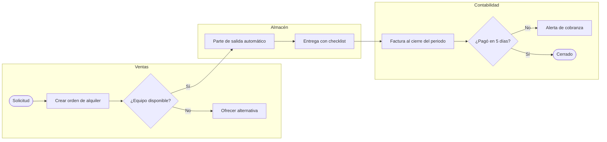

# Procesos de negocio (BPM)

La idea simple: automatizar un proceso malo solo produce errores más rápido. Primero se arregla el
proceso, después se programa.

## Método

1. **Identifica los procesos** involucrados. Si el alcance es difuso, arranca con un SIPOC por
   proceso: Suppliers, Inputs, Process (5-7 pasos), Outputs, Customers.
2. **AS-IS:** cómo funciona HOY, con quién, con qué herramienta (Excel, WhatsApp, papel) y dónde
   duele. Si no tienes datos, marca los supuestos y di a quién hay que preguntarle.
3. **Busca desperdicios (Lean):** esperas, reprocesos, doble digitación, aprobaciones inútiles,
   información que se busca en varios sitios, excepciones que se volvieron regla.
4. **TO-BE:** para cada paso decide eliminar, automatizar, controlar o mantener, y quién responde.
   Elimina antes de automatizar.
5. **RACI** de las actividades clave.
6. **Ejemplo concreto de ESA empresa**, con datos de su rubro.
7. **KPIs:** 3-5 por proceso, con fórmula, línea base (o "por medir") y meta.
8. **Módulos:** recién aquí traduces el TO-BE a sistema.
9. **PDCA:** indica quién revisa los KPIs, con qué frecuencia y qué dispara un cambio.

## Plantilla

```markdown
### Proceso: <nombre>
**AS-IS:** <flujo actual en 3-6 pasos>
**Dolores:** <dolor → consecuencia medible>
**TO-BE:**
| Paso | Decisión | Detalle | Responsable |
|------|----------|---------|-------------|
| ...  | Eliminar / Automatizar / Controlar / Mantener | ... | ... |

**Ejemplo aplicado:** <caso real de esta empresa>
**RACI:**
| Actividad | Gerencia | Ventas | Almacén | Contabilidad |
|-----------|----------|--------|---------|--------------|
| ...       | A        | R      | C       | I            |

**KPIs:**
| KPI | Fórmula | Línea base | Meta | Frecuencia |
```

RACI: **R** ejecuta, **A** rinde cuentas (uno solo por actividad), **C** consultado, **I** informado.
Dos "A" en una fila significa que nadie responde de verdad.

## Procesos núcleo

| Proceso | Puntos de control típicos | KPIs de partida |
|---------|---------------------------|-----------------|
| **Lead-to-Customer** | Origen del lead, calificación, cotización, aprobación de descuentos | Conversión por etapa, tiempo de respuesta, ciclo de venta |
| **Order-to-Cash** | Pedido, entrega, facturación, cobranza | DSO (días promedio de cobro), % cartera vencida, tiempo pedido-factura, % facturas con error |
| **Procure-to-Pay** | Requerimiento, orden de compra, recepción, conciliación de 3 vías, pago | Tiempo de ciclo, % compras sin orden, % pagos a tiempo |
| **Inventario y activos** | Entradas, salidas, kardex, mantenimiento, alquiler de equipos | % equipos ociosos, exactitud de inventario, rotación, disponibilidad |
| **Record-to-Report** | Asientos, conciliaciones, cierre, reportes, obligaciones SUNAT | Días de cierre, ajustes post-cierre, declaraciones a tiempo |
| **Hire-to-Retire** | Alta, contrato, asistencia, planilla, cese | Tiempo de contratación, errores de planilla, rotación |
| **Atención y postventa** | Registro, SLA, solución, retroalimentación | Tiempo de primera respuesta, resolución al primer contacto, CSAT |

Los procesos se tocan: una factura mal emitida en Order-to-Cash contamina Record-to-Report. Señala
esas fronteras porque ahí nacen las integraciones y la doble digitación.

## Ejemplo: alquiler de maquinaria

**AS-IS.** El contrato se arma en Word; almacén se entera por WhatsApp; el parte de salida es en
papel; contabilidad factura a fin de mes revisando cuadernos; nadie sabe qué equipo está ocioso.

**TO-BE.** La orden de alquiler genera automáticamente el parte de salida, reserva el equipo
(rechazando traslapes), emite la factura al cierre del periodo y dispara la alerta de cobranza a los
5 días de vencida.

**KPIs.** % equipos ociosos, días promedio de cobro, tiempo de cierre de orden a factura, ingresos
perdidos por devolución sin facturar.

## BPMN simplificado en Mermaid

Usa carriles por rol con `subgraph` y rombos para las decisiones. Un diagrama por proceso; si pasa
de unos 15 nodos, divídelo. Diagrama solo lo que aclara algo.



## Del TO-BE al sistema

- Cada paso automatizado se vuelve un caso de uso; cada control, una regla en un SP.
- Cada estado del proceso se vuelve un estado de entidad, con transiciones validadas.
- Cada KPI exige que el dato se capture: si un KPI no se puede calcular con el modelo, al modelo le
  falta algo. Revísalo antes de cerrar el diseño.
- Cada columna "A" del RACI orienta los permisos, sin convertirse en roles fijos en el código.
- Si un paso no agrega valor y el cliente insiste en digitalizarlo, explícale el costo. Si aun así lo
  quiere, regístralo como decisión del cliente en el anexo.
