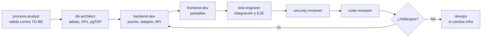

# Entorno de Claude Code para un proyecto

Verificado contra la documentación oficial (`code.claude.com/docs`) en noviembre de 2026. Claude Code
cambia rápido: ante la duda, consulta `sub-agents`, `hooks`, `skills`, `memory` y `permissions` antes de
afirmar una sintaxis.

## Qué entregar

| Archivo | Template | Función |
|---------|----------|---------|
| `CLAUDE.md` | `assets/claude-code/CLAUDE.md.template` | Lo que Claude debe saber siempre |
| `.claude/rules/*.md` | `assets/claude-code/rules/` | Reglas que cargan solo al tocar ciertas rutas |
| `.claude/agents/*.md` | `assets/claude-code/agents/` | Equipo de subagentes |
| `.claude/settings.json` | `assets/claude-code/settings.json` | Permisos y hooks |
| `.claude/hooks/*.mjs` | `assets/claude-code/hooks/` | Barreras automáticas |
| `.claude/skills/<nombre>/SKILL.md` | `assets/claude-code/skills/*/SKILL.md.template` | Flujos con `/nombre` |

Adapta todo al proyecto real: nombres de comandos, rutas, reglas y agentes. Los templates describen el
Perfil ERP; en el Perfil Express cambia el backend, frontend y db-architect, y quita lo de SPs.

## Lo que hay que saber

**CLAUDE.md.** La doc recomienda menos de 200 líneas: uno más largo consume contexto y se cumple peor.
Los imports `@ruta` ordenan, pero no reducen contexto. Lo específico de una parte del código va en
`.claude/rules/` con frontmatter `paths`, que carga solo cuando se trabaja en esas rutas.

**CLAUDE.md es orientación; settings y hooks son barreras.** Lo que nunca debe ocurrir no puede depender de
que el modelo lo recuerde: va en `permissions.deny` o en un hook. Las reglas se evalúan `deny` → `ask` →
`allow`, y un `allow` no abre excepciones dentro de un `deny`.

**Límite real de `Read` deny.** Cubre las herramientas de archivos y comandos reconocidos como `cat`, pero no
a un script Python o Node que abra el archivo por su cuenta. Para aislamiento real está el sandbox del sistema
operativo. No prometas que los secretos quedan inaccesibles solo con estas reglas.

**Subagentes.** Solo `name` y `description` son obligatorios. Sin `tools` heredan todas: por eso se listan.
`description` orienta la delegación automática. En estos templates, cada agente se usa solo a pedido de Fernando (ver "Solo a pedido"). Campos útiles: `tools`,
`disallowedTools`, `model`, `permissionMode`, `hooks`, `memory`, `skills`, `isolation`. Un campo desconocido se
ignora **sin error**, así que una errata en una restricción pasa desapercibida: revisa con cuidado.

**Hooks.** Formato `evento → matcher → handlers`. Con `exit 2`, el `stderr` bloquea y se muestra a Claude;
`exit 1` es un error no bloqueante. Eso es importante: **un hook de seguridad que falla con `exit 1` deja
pasar la acción.** Los hooks incluidos usan Node por funcionar igual en Windows y Linux. En Windows, Claude
Code puede usar `Bash` y `PowerShell`, por lo que el matcher incluye ambos.

**Slash commands.** Se fusionaron con las skills: `.claude/commands/x.md` sigue funcionando, pero la doc
recomienda `.claude/skills/x/SKILL.md`. Usa `disable-model-invocation: true` para flujos que solo debe iniciar
una persona. Los argumentos llegan en `$ARGUMENTS`.

**Los hooks de Claude no sustituyen a CI.** Solo protegen lo que hace Claude; un commit manual los esquiva. La
verificación obligatoria vive en CI.

## El equipo de subagentes

Los subagentes tienen contexto propio. Su ventaja no es "más inteligencia", sino foco, permisos mínimos y una
segunda mirada sin el sesgo de quien escribió el código.

| Agente | Por qué existe | Si no lo tuvieras | Tools |
|--------|---------------|-------------------|-------|
| `process-analyst` | Contrasta la feature con el TO-BE | Software correcto que automatiza el proceso equivocado | Read, Grep, Glob |
| `db-architect` | Diseña tablas, SPs, índices y permisos | Reglas fuera de SPs, permisos flojos, migraciones peligrosas | Read, Write, Edit, Grep, Glob, Bash |
| `backend-dev` | Implementa el hexágono | Lógica filtrada a controllers y SQL suelto | Read, Write, Edit, Grep, Glob, Bash |
| `frontend-dev` | Implementa Vue + PrimeVue | Componentes inconsistentes y sin estados | Read, Write, Edit, Grep, Glob, Bash |
| `security-reviewer` | Revisa con mentalidad de atacante | Quien escribió el código no ve sus propios huecos | Read, Grep, Glob, Bash restringido |
| `test-engineer` | Escribe tests desde los criterios | Tests que confirman la implementación en vez de los requisitos | Read, Write, Edit, Grep, Glob, Bash |
| `devops` | Docker, CI/CD, VPS, backups | Puertos expuestos, deploys manuales, backups sin probar | Read, Write, Edit, Grep, Glob, Bash |
| `code-reviewer` | Última revisión de calidad | Deuda y deriva que se van acumulando | Read, Grep, Glob, Bash restringido |

Los revisores no reciben `Write` ni `Edit`: quien revisa no corrige en silencio. Su `Bash` queda limitado por el
hook `readonly-bash.mjs`, declarado en su frontmatter.

**Sobre-ingeniería.** Ocho agentes son la base de un proyecto mediano o grande. Para algo chico bastan
`db-architect`, `code-reviewer` y `security-reviewer`. Cada invocación consume tokens y arranca sin contexto:
una tarea pequeña se hace mejor directamente.

## Solo a pedido

Cada subagente gasta tokens y arranca sin contexto, así que Fernando decide cuándo usarlos.

- **Cómo invocarlos:** `@agent-<nombre>` garantiza ese agente; nombrarlo en lenguaje natural normalmente también
  funciona. Los comandos como `/new-module` cuentan como pedido, porque Fernando los ejecuta.
- **Límite real:** Claude Code no tiene un equivalente a `disable-model-invocation` para subagentes. La regla vive
  en `description` y `CLAUDE.md`: reduce la delegación automática, pero no la impide al 100%.
- **Bloqueo duro:** `permissions.deny` con `Agent(nombre)` o `Agent` impide que Claude delegue, pero la doc no aclara
  si también bloquea `@agent-` o `--agent`. Pruébalo antes de usarlo, porque podría romper estos flujos.

## Flujo para un módulo

Por qué en este orden: el proceso define el contrato de datos, la base define el contrato de la API y la API
el de la pantalla. Empezar por la pantalla suele obligar a rehacer las capas inferiores.

## Instalación en un proyecto

1. Copia y adapta los archivos a las rutas de la tabla (quita `.template` de los nombres).
2. Define `npm run verify` (lint, typecheck y tests rápidos), que usa el hook previo al commit.
3. Prueba los hooks con una entrada simulada y dentro de una sesión real.
4. Explica a Fernando cada regla que agregaste, y por qué.
